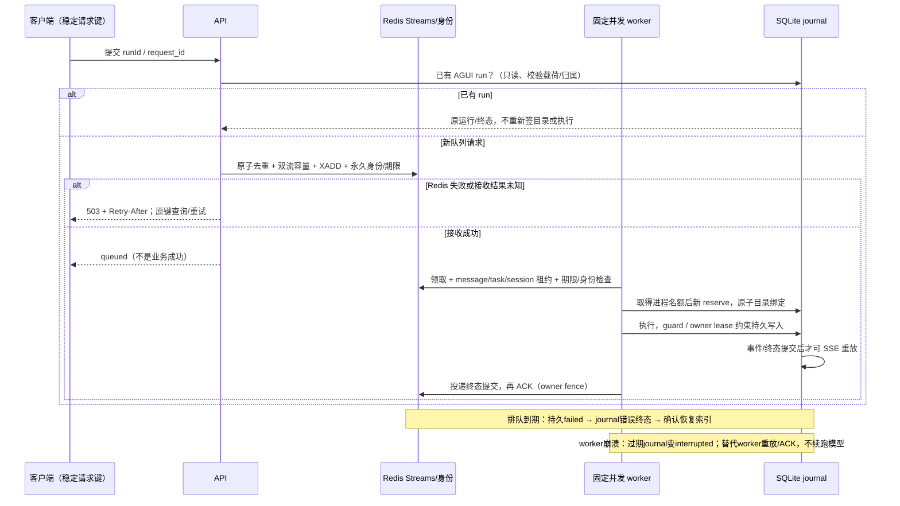

# M5：有界恢复集成验收

日期：2026-10-16（Asia/Shanghai）。冻结基线 M4 `6b4128960a520a25f5a5e8ed56c0b00675a3e5fd`；半开探测 `993fa69`；准入、保留、期限和统一探针 `1bf13338d92373fcc23b445ab9d0098308f6c44c`；最终仅测试导入隔离修正 `a04e8f1`。最终结果在 [验收清单](../../../eval/verification/2026-10-16-m5-integration/README.md) 逐项列明。

## 范围

保留 Redis Streams / XAUTOCLAIM / 租约 / ACK / 死信及既有交易幂等，不引入第二种队列、不迁 PostgreSQL，不宣称 exactly-once。冻结前先在独立 worktree 测 M4 完整后端、安全合同和签名 HTTP mock；新旧源码独立，不 reset 活跃工作树。默认目录仍5,700件，未改正式检索策略、留出集、真实库存或凭据。

功能细节及启用/回退分别见：

- [共享准入与运行终态](M5-准入与运行终态.md)
- [队列身份保留与期限](M5-队列保留与期限.md)
- [原子半开探测](M5-原子半开探测.md)

## 接受与恢复时序

无 Redis 且明确禁用队列时，API 使用相同进程 gate；满载即时503，不创建等待协程或 phantom run。配置了队列却初始化失败不能进入该分支。legacy 客户端需提供稳定 request_id 才能跨网络重试定位原提交；未提供时每次仍是新请求。legacy 等待响应有既有等待期限，其任务终态从 Redis 读；AGUI 以 journal 为业务运行事实。某次投递 done 可对应 interrupted/error，不表示下单或支付成功。

## 固定故障与负载口径

统一 `scripts/ci/bounded_recovery_probe.py` 在新旧两树运行同一驱动，仅150ms合成Agent。11项包括 B=2 准入、legacy容量、wrongtype、提交前失败、提交后响应丢失、旧短TTL、排队/运行期限、journal终态后状态失败、ACK失败、真实worker SIGKILL与精确SSE重放。每项保留观测层级；ASGI HTTP 不冒充真实socket，独立容量负载才用回环HTTP与独立API/worker进程。Redis AOF重启另由真实进程专项覆盖。

同驱动旧版8项目标合同失败、3项既有恢复合同通过。原始失败不是产品回归失败数量，不能与完整pytest计数混淆。半开旧版32个探针同时获准、32次失败只留下1次；新原子驱动为1个探针、32次累计。并发/旧owner/取消/进程退出另有专项。

原计划45秒×3的基线负载被执行任务生命周期中断，只留下4个完整单元；没有最终report，不当完整容量验收。原目录保留。替代矩阵明确改为短窗口诊断：inline/queue，用户1/2/4/8，每格5秒×3，20次预热，20ms拒绝退避，B=2、queue cap=2、worker concurrency=2，新旧参数相同；以accepted/rejected/terminal/unknown/censored、active_peak与queue depth作边界证据。保存每请求账本、每PID CPU/RSS、时间线、p50/p95、队列等待、吞吐和drain。SQLite内部锁等待没有仪表，为unknown。旧段前期与17秒专项有重叠；未独占整机、未随机交叉，短窗延迟差异不构成收益。

本轮可守住的目标是配置B=2时实际在途不超过2、已接受任务收口、过载显式拒绝、未知接收不偷偷执行；不把默认8称为最优容量。逻辑CPU可见9、宿主内存约9.7GiB，cgroup未挂载，实际配额未知。没有足够证据提出PostgreSQL迁移。

## 停止条件与外部门禁

任何越权、重复交易副作用、不可恢复丢身份、旧owner写入、已接受却永久未知均阻塞验收，保留原失败并修复；容量超B/queue cap、未收口/censored也不得用吞吐均值掩盖。观察不到的内部锁等待、宿主资源限额与生产RTO保持未知。

完整真实模型smoke、真实Chromium、真实容器升级/回退、TLS/公开入口、生产容量，以及M3人工数据审核/上游许可仍独立列为未完成。不得把mock或离线合同写成真实模型/生产效果通过。新配置的Compose显式透传与受控存量TTL升级步骤交M6，M5没有改用户环境或迁移已有运行数据。
