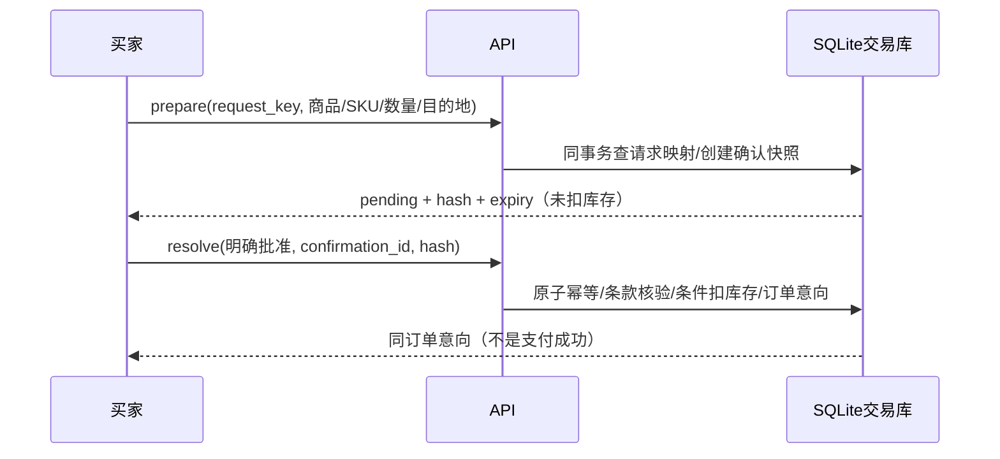

# 求职证据与设计取舍

## 项目范围与来源

Voyacart 基于开源电商 Agent 课程工程二次开发。使用 FastAPI、AgentScope、SQLite、Redis Streams、Qdrant、React；不接入真实支付或物流。此次实施使用 AI 编程辅助。下列内容描述可复核的项目能力，并不证明求职者亲自独立编写了全部代码；个人贡献应以能解释、复现、修改和评审的范围如实确定。

原工程已包含框架装配、Agent/工具、交易确认、事件日志、检索和部分故障演练；本轮重点是补缺口及明确保证边界，不能把它们全部写成从零原创。

## 三个设计决定

### 1. 共享磁盘的单机 SQLite，而不是直接换连接串

交易依赖唯一约束、短事务、条件库存扣减、确认和订单同事务。多状态库/Redis 的恢复需要停写快照，单个 DB online backup 不提供跨系统原子性。当前确定目标是单机演示，跨主机写入和完整容量需求未获实证；没有仅靠 PostgreSQL 连接串解决所有瓶颈。

证据：[交易存储](../app/infrastructure/persistence/sql/trade_store.py)、[M2](../eval/verification/2026-10-16-m2-integration/README.md)、[M5容量边界](../eval/verification/2026-10-16-m5-load-comparison/report.md)、[M6](../eval/verification/2026-10-16-m6-integration/README.md)。

### 2. 两层幂等与用户批准边界

prepare 的请求键负责双击/响应丢失重试，同键同载荷返回原确认、异载荷冲突；resolve 的操作 ID 负责一张确认至多一次副作用。prepare 不预留库存，批准时仍校验当前价格/币种/数量/期限。候选是历史快照，重新核验也不等于执行授权。

证据：[确认用例](../app/application/usecases/confirmation_service.py)、[M2a](改动记录/2026-10-16/M2a-prepare请求幂等.md)、[M4](../eval/verification/2026-10-16-m4-integration/README.md)。

### 3. 重放已提交事实，不承诺重新执行模型恰好一次

Redis Streams 是至少一次投递；租约和 fence 防止旧 owner 写入；journal 负责事件/终态。重连重放事件，worker 崩溃后原 run 可标 interrupted，替代 worker 重放/ACK 而不是续跑不可恢复的模型生成。运行接收有上限，未知入队返回503并要求原键查询，不静默切到 API 无限执行。

证据：[M5时序](改动记录/2026-10-16/M5-有界恢复集成验收.md)、[运行准入](../app/application/run_admission.py)、[队列](../app/infrastructure/queue/redis_stream_queue.py)、[恢复矩阵](../eval/verification/2026-10-16-m5-candidate-probe-accepted/report.json)。

## 可以按实际个人参与范围使用的简历表述

- 在课程电商 Agent 基础上改造交易入口，补齐 prepare 请求幂等、签名身份/归属校验及审核后持久化输出；用双买家、重试/竞争和合成敏感串测试验证边界。
- 实现商品/SKU 持久候选与比较流程，结合来源绑定、revision 冲突与确认前核验，完成 mock HTTP 的选购、明确批准、意向查看和刷新恢复。
- 基于 Redis Streams、SQLite journal、租约/fencing 完善有界准入、队列期限及重投收口；固定 B=2 的短窗合成负载中实际在途不超过2，受理任务全部有终态。注明这是离线 mock 边界实验，不代表生产吞吐。
- 建立分层离线 CI、版本指纹与故障/恢复证据，将后端回归、前端构建、HTTP、真实模型、浏览器和部署门禁分开记录。

每条都需能回答“修改了什么”“为什么这样做”“失败过什么”“保证什么/不保证什么”“证据对应哪个版本”。“使用 AI 辅助”与技术理解并不冲突，不能把代码提交作者当独立创作证明。

## 数字的使用条件

| 数字 | 可以说明 | 不能说明 |
|---|---|---|
| 历史12,299商品、300 test查询、nDCG@10 0.6131、Exact Recall@50 0.7995 | 冻结 ESCI v2、指定模型/策略/判分下的历史检索结果 | 当前默认5,700运行目录的线上质量、严格v1/v2收益、Agent整链成功率 |
| 历史500并发批准抢100库存，100单/库存0 | 那次固定环境下交易层不超卖实验 | 全站500并发稳定服务或支付成功 |
| M5 B=2、候选active峰值≤2、unknown/censored=0 | 固定150ms mock及5秒×3短窗的准入/收口边界 | 最佳默认配置、生产RTO、长期可用性或性能提升 |
| 前后端与合同通过数量 | 对应版本的自动测试覆盖范围 | 业务准确率、人工QA完成度、真实浏览器或真实模型成功 |
| 备份/恢复阶段计时 | 此次临时数据与机器的演练观测 | 生产RPO/RTO、零丢失、高可用 |

历史检索报告：[ESCI v2](../eval/verification/2026-10-15-esci-formal-eval-v2/README.md)。类目78.5%是批量/单件一致率，不是准确率；人工200/50抽检仍未执行。来源许可及模型推断限制见[数据卡](数据卡/ESCI目录数据卡.md)。

## 应直接承认的限制

- 单机共享磁盘，非跨主机高可用；没有 exactly-once 承诺
- 价格/库存/配送为合成演示，生成未支付意向，不接真实履约
- 新源码未 push，没有对应新 GitHub CI 链接
- 完整真实模型、浏览器、Docker/TLS/生产恢复门禁未通过
- 不合作协程的远端副作用不能撤回；资源/等待边界不等于硬实时杀进程
- 永久身份/墓碑/候选操作记录会增长，有界准入不等于存储总量常数

完整交付入口：[演示与恢复手册](交付与恢复手册.md)、[M6验收](../eval/verification/2026-10-16-m6-integration/README.md)。
